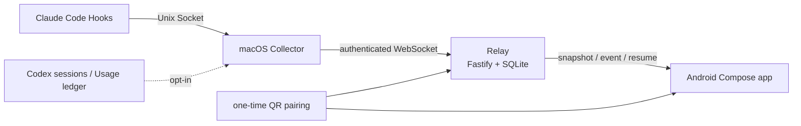

English | [简体中文](./README.md)

# Claude Phone Monitor

[](https://github.com/S-zhi/ClaudePhoneMonitor/actions/workflows/ci.yml)


A trusted-LAN phone monitor for Claude Code. Claude Hooks on macOS send allowlisted lifecycle events to a local Collector, the Collector forwards them to a Relay over WebSocket, and the Android app displays task, session, and connection state after a QR pairing flow. Optional features include read-only Codex monitoring, Claude/Codex usage totals, and an explicitly enabled phone approval bridge.

## Documentation

- 🚀 [Quick Start](#quick-start)
- ⚙️ [Configuration and Commands](#configuration-and-commands)
- 🏗 [Architecture and Project Structure](#architecture-and-project-structure)
- 🧪 [Tests and CI](#tests-and-ci)
- 🔒 [Privacy and Current Limitations](#privacy-and-current-limitations)
- 📚 [Real LAN Deployment](docs/real-lan-deployment.md) · [CI and Local Reproduction](docs/ci.md) · [Local Development](docs/local-development.md)
- 🧩 [Relay documentation](services/relay/README.md) · [Collector documentation](services/collector/README.md)
- 🎨 [Android design and device validation](docs/clawd-ui-design.md) · [Issue #8 validation](docs/issue-8-device-validation.md)

## Core Capabilities

- One-time QR pairing and role-scoped tokens. Collector and Android use different tokens, while the Relay persists pairing, event sequence, snapshot, and resume state.
- A real Android client built with Kotlin and Jetpack Compose. Tokens are stored in Android Keystore and snapshots/events arrive over WebSocket; Mock/Demo controls are not included.
- Local macOS collection. Hooks hand data to the Collector over a Unix socket; the default telemetry path is fail-open and supports an outbox, reconnects, heartbeats, and launchd installation.
- Opt-in extensions. `--watch-codex` reads Codex lifecycle data, `--watch-usage` aggregates local Claude/Codex usage, and `--approval-bridge` enables the Claude `PermissionRequest` phone decision path.

## Quick Start

### Requirements

- macOS runs Claude Code, the Relay, and the Collector; the Android phone and Mac must be on the same trusted LAN.
- Node.js **24.13.0** (see `.node-version`).
- Android builds require JDK 21, Android SDK Platform 35, and Build Tools 35.0.0. The Gradle Wrapper is committed. See the [CI guide](docs/ci.md) for complete SDK, JDK, license, and environment prerequisites.
- Android must use the Mac's LAN IP. `127.0.0.1` on the phone points to the phone itself.

### Install and start

```bash
npm run ci:install
scripts/start-lan-monitor.sh --pair --install-hooks --open-qr --configure-usage
```

The launcher builds the Relay and Collector, starts the Relay, creates or reuses a bootstrap secret, generates a one-time `pairing.png`, and merges user-level `~/.claude/settings.json` when `--install-hooks` is supplied. The first run stores restricted local state and pairing data under `~/.claude-phone-monitor/`.

Double-click [Start Claude Phone Monitor.command](./Start%20Claude%20Phone%20Monitor.command) in Finder to run the same launcher flow.

1. Build and open the Android debug APK using [Android Build](#android-build), then scan `pairing.png`.
2. Wait for the app to claim the pairing and show the Relay connection.
3. Run Claude Code on the Mac; task state flows from Collector to Relay to Android.

See [Android Build](#android-build) for the APK command and [Real LAN Deployment](docs/real-lan-deployment.md) for the full checklist.

### Common launcher options

```bash
scripts/start-lan-monitor.sh
scripts/start-lan-monitor.sh --pair
scripts/start-lan-monitor.sh --watch-codex
scripts/start-lan-monitor.sh --watch-usage
scripts/start-lan-monitor.sh --approval-bridge
scripts/start-lan-monitor.sh --no-approval-bridge
```

`--install-hooks` and `--approval-bridge` change user-level Claude Hook configuration. `--approval-bridge` can block the Claude Hook for up to 10 minutes, covers Claude `PermissionRequest` only, and requires checking the pending operation on the computer before approving; choose “Handle on computer” when it cannot be identified reliably. Omit these options when you only want to start the services. Press `Ctrl-C` to stop the Relay and Collector started by this launcher.

## Configuration and Commands

Real deployments should use a persistent database and a bootstrap secret:

| Variable | Default | Purpose |
| --- | --- | --- |
| `RELAY_HOST` | `0.0.0.0` | Relay HTTP/WebSocket bind address |
| `RELAY_PORT` / `PORT` | `8787` | Relay port |
| `RELAY_PUBLIC_URL` | unset (Relay default) | Mac LAN HTTP address written into the QR; the launcher fills it when unset |
| `RELAY_BOOTSTRAP_SECRET` | unset | Bearer used to create a real pairing; never commit it |
| `RELAY_DB_PATH` | unset (Relay default) | SQLite path; the launcher falls back to `~/.claude-phone-monitor/relay.sqlite` when unset, while manual starts should set it explicitly |
| `CLAUDE_PHONE_MONITOR_HOME` | `~/.claude-phone-monitor` | Pairing, logs, Usage preference, and local state directory |
| `COLLECTOR_WATCH_CODEX` | `0` | Enable read-only Codex session monitoring for this launch |
| `COLLECTOR_WATCH_USAGE` | `0` | Enable local Claude/Codex usage collection for this launch |

See [services/relay/README.md](services/relay/README.md) for all Relay variables and the HTTP/WebSocket contract, and [services/collector/README.md](services/collector/README.md) for source directories, the Usage ledger, and Codex metadata boundaries.

To start the Relay manually:

```bash
npm --prefix services/relay run build
RELAY_HOST=0.0.0.0 \
RELAY_PUBLIC_URL=http://192.168.1.3:8787 \
RELAY_BOOTSTRAP_SECRET='replace-with-a-long-url-safe-secret' \
RELAY_DB_PATH="$HOME/.claude-phone-monitor/relay.sqlite" \
npm --prefix services/relay run start
```

Verify it with:

```bash
curl --fail http://127.0.0.1:8787/healthz
```

The main Relay entry points are `GET /healthz`, `POST /v1/pairing`, `POST /v1/pairing/:pairing_id/claim`, `/ws/collector`, and `/ws/android`. Tokens are sent in JSON messages, never as URL query parameters.

## Architecture and Project Structure



```text
apps/android/          Kotlin + Jetpack Compose real-mode client
packages/protocol/     shared v1 TypeScript protocol and privacy rules
services/collector/    macOS collector, Hook adapter, outbox and watchers
services/relay/        LAN HTTP/WebSocket relay and SQLite persistence
skills/claude-monitor/ pairing, install, doctor, status and uninstall scripts
scripts/               LAN launcher and CI helpers
tests/                 protocol, integration and LAN contract tests
docs/                  deployment, CI, design and device-validation notes
```

## Android Build

```bash
./gradlew --no-daemon :apps:android:lintDebug :apps:android:testDebugUnitTest :apps:android:assembleDebug
```


This is a screenshot from a real Android device showing the Relay-connected LAN state.

The debug APK is written to `apps/android/build/outputs/apk/debug/android-debug.apk`. The app is landscape-only, hides system bars, supports QR pairing, Keystore tokens, real WebSocket snapshots/events, and Clawd state animation. Reminder policy, sound reminders, the approval page, and asset provenance are documented in [Issue #17](docs/issue-17-reminder-policy.md), [Issue #26](docs/issue-26-sound-reminders.md), [Issue #23](docs/issue-23-approval-reminder.md), and [Issue #8](docs/issue-8-pet-actions.md).

## Tests and CI

Recommended Node checks:

```bash
npm run ci:install
npm run lint
npm run typecheck
npm run check:shell
npm run check:workflows
npm run build
npm run test:unit
npm run test:integration
npm run test:helpers
npm run test:github
npm run test:ci
npm run test:live
```

`npm run test:live` uses a temporary loopback Relay, SQLite database, and secret. It does not connect to Claude or a deployed service. The real-LAN contract test is opt-in:

```bash
RELAY_BASE_URL=http://192.168.1.3:8787 \
RELAY_BOOTSTRAP_SECRET='your-secret' \
node --test tests/real-lan-contract.test.mjs
```

Replace `192.168.1.3` with the LAN address of the Mac running the Relay. It must match the `RELAY_PUBLIC_URL` address encoded in the QR.

GitHub Actions runs Node checks and Android checks on pull requests and pushes to `main`. See [docs/ci.md](docs/ci.md) for prerequisites and artifact details.

## Privacy and Current Limitations

The protocol, Collector, and Relay use allowlisted fields. Only event type, tool name, duration, exit code, waiting reason, safe session titles, approval metadata, redacted IDs, timestamps, and sequence data cross the phone boundary. Prompts, tool input/output, commands, paths, stdout/stderr, secrets, and authorization headers are discarded; Usage sends aggregate totals only, and Codex monitoring reads local session metadata.

- The LAN MVP uses unencrypted `ws://` and is intended for a trusted LAN. Use WSS/TLS before crossing networks or exposing the Relay publicly.
- FCM background push is not implemented; reminders currently rely on the foreground WebSocket.
- Codex session formats can change between versions and monitoring must be explicitly enabled. Unknown states are not inferred as completion, errors, or approvals.
- The approval bridge is optional, and deadline recovery after the Android process exits is not persisted. Read the [Issue #23 boundaries](docs/issue-23-approval-reminder.md) before enabling it.

## Contributing, Help, and License

Issues are welcome for bugs, documentation problems, and feature requests. Before opening a pull request, run the Node and Android checks above and describe the scope of any real-device validation.

This repository currently has no `SECURITY.md` or dedicated security disclosure address. Do not paste secrets, tokens, or raw session data into a public issue; maintainers should add a formal disclosure channel. The repository also has no declared license, so maintainers need to add one before public redistribution.
