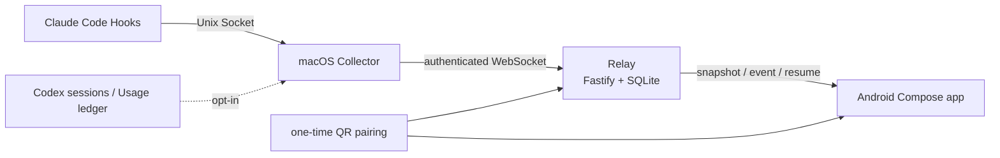
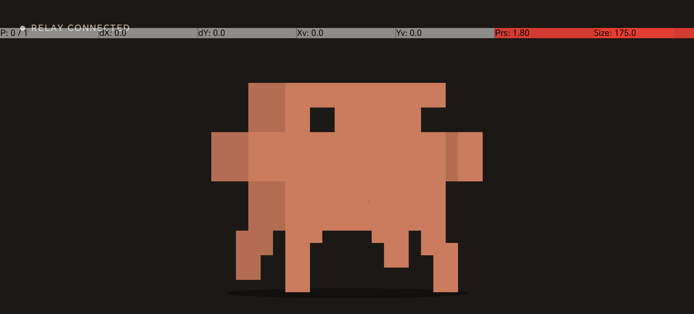

[English](./README.en.md) | 简体中文

# Claude Phone Monitor

[](https://github.com/S-zhi/ClaudePhoneMonitor/actions/workflows/ci.yml)


一个面向 Claude Code 的局域网手机监控器：macOS 上的 Claude Hook 把经过白名单过滤的生命周期事件交给 Collector，Collector 通过 WebSocket 发送到 Relay，Android 应用扫码配对后显示任务、会话和连接状态。项目还支持可选的 Codex 只读监听、Claude/Codex 用量汇总，以及需要明确开启的手机审批桥。

## 文档导航

- 🚀 [快速开始](#快速开始)
- ⚙️ [配置与常用命令](#配置与常用命令)
- 🏗 [架构与目录](#架构与目录)
- 🧪 [测试与 CI](#测试与-ci)
- 🔒 [隐私与当前限制](#隐私与当前限制)
- 📚 [真实 LAN 部署](docs/real-lan-deployment.md) · [CI 与本地复现](docs/ci.md) · [本地开发](docs/local-development.md)
- 🧩 [Relay 文档](services/relay/README.md) · [Collector 文档](services/collector/README.md)
- 🎨 [Android 设计与设备验证](docs/clawd-ui-design.md) · [Issue #8 验证](docs/issue-8-device-validation.md)

## 核心能力

- 一次性 QR 配对和角色令牌：Collector 与 Android 使用不同令牌，Relay 持久化配对、事件序号、快照和 resume 状态。
- Android 真实模式：Kotlin + Jetpack Compose 横屏客户端，令牌存入 Android Keystore，通过 WebSocket 接收 snapshot/event；当前不包含 Mock/Demo 客户端。
- macOS 本地采集：Hook 经 Unix Socket 交给 Collector，默认 fail-open；Collector 支持 outbox、重连、心跳和 launchd 安装。
- 可选扩展：`--watch-codex` 只读观察本机 Codex 生命周期，`--watch-usage` 汇总本机 Claude/Codex 用量，`--approval-bridge` 才启用 Claude `PermissionRequest` 的手机决策入口。

## 快速开始

### 环境要求

- macOS 运行 Claude Code、Relay 和 Collector；Android 手机与 Mac 位于同一可信局域网。
- Node.js **24.13.0**（见 `.node-version`）。
- 构建 Android 需要 JDK 21、Android SDK Platform 35、Build Tools 35.0.0；Gradle Wrapper 已提交。完整 SDK、JDK、许可证和环境变量前置条件见 [CI 指南](docs/ci.md)。
- Android 连接必须使用 Mac 的局域网 IP；`127.0.0.1` 在手机上指向手机自身。

### 安装依赖并启动

```bash
npm run ci:install
scripts/start-lan-monitor.sh --pair --install-hooks --open-qr --configure-usage
```

启动脚本会构建 Relay/Collector、启动 Relay、生成或复用 bootstrap secret、创建一次性 `pairing.png`，并在传入 `--install-hooks` 时合并用户级 `~/.claude/settings.json`。首次运行会在 `~/.claude-phone-monitor/` 保存受限权限的状态和配对配置。

在 Finder 中双击 [Start Claude Phone Monitor.command](./Start%20Claude%20Phone%20Monitor.command) 也会执行这条启动流程。

1. 先按 [Android 构建](#android-构建)生成并打开 Android Debug APK，扫描 `pairing.png`。
2. 等待应用完成 claim 并显示 Relay 连接状态。
3. 在电脑上运行 Claude Code；任务状态会通过 Collector → Relay → Android 更新。

APK 构建命令见[Android 构建](#android-构建)。完整的 Mac/Android 检查清单见[真实 LAN 部署](docs/real-lan-deployment.md)。

### 常用启动选项

```bash
scripts/start-lan-monitor.sh
scripts/start-lan-monitor.sh --pair
scripts/start-lan-monitor.sh --watch-codex
scripts/start-lan-monitor.sh --watch-usage
scripts/start-lan-monitor.sh --approval-bridge
scripts/start-lan-monitor.sh --no-approval-bridge
```

`--install-hooks`、`--approval-bridge` 会修改用户级 Claude Hook 配置；`--approval-bridge` 最长阻塞 Claude Hook 10 分钟，仅覆盖 Claude `PermissionRequest`；批准前请先在电脑核对待执行操作，无法可靠识别时选择“在电脑处理”。只想启动服务时不要传这两个选项。启动脚本按 `Ctrl-C` 只停止本次启动的 Relay/Collector。

## 配置与常用命令

真实部署至少要使用持久化数据库和 bootstrap secret：

| 变量 | 默认值 | 说明 |
| --- | --- | --- |
| `RELAY_HOST` | `0.0.0.0` | Relay HTTP/WebSocket 监听地址 |
| `RELAY_PORT` / `PORT` | `8787` | Relay 端口 |
| `RELAY_PUBLIC_URL` | unset（Relay 默认） | 写入 QR 的 Mac 局域网 HTTP 地址；启动脚本未设置时自动填充 |
| `RELAY_BOOTSTRAP_SECRET` | 未设置 | 创建真实配对所需的 bearer；不要提交到仓库 |
| `RELAY_DB_PATH` | unset（Relay 默认） | SQLite 路径；启动脚本未设置时回退到 `~/.claude-phone-monitor/relay.sqlite`，手动启动时应显式设置 |
| `CLAUDE_PHONE_MONITOR_HOME` | `~/.claude-phone-monitor` | pairing、日志、Usage 偏好和本地状态目录 |
| `COLLECTOR_WATCH_CODEX` | `0` | 当前启动是否只读监听 Codex sessions |
| `COLLECTOR_WATCH_USAGE` | `0` | 当前启动是否读取本机 Claude/Codex 用量 |

Relay 的完整变量和 HTTP/WebSocket 合约见 [services/relay/README.md](services/relay/README.md)；Collector 的来源目录、Usage 账本和 Codex 元数据边界见 [services/collector/README.md](services/collector/README.md)。

手动启动 Relay 时，可使用：

```bash
npm --prefix services/relay run build
RELAY_HOST=0.0.0.0 \
RELAY_PUBLIC_URL=http://192.168.1.3:8787 \
RELAY_BOOTSTRAP_SECRET='replace-with-a-long-url-safe-secret' \
RELAY_DB_PATH="$HOME/.claude-phone-monitor/relay.sqlite" \
npm --prefix services/relay run start
```

验证服务：

```bash
curl --fail http://127.0.0.1:8787/healthz
```

Relay 的主要入口是 `GET /healthz`、`POST /v1/pairing`、`POST /v1/pairing/:pairing_id/claim`、`/ws/collector` 和 `/ws/android`。令牌只放在 JSON 消息中，不放在 URL 查询参数中。

## 架构与目录



```text
apps/android/          Kotlin + Jetpack Compose real-mode client
packages/protocol/     shared v1 TypeScript protocol and privacy rules
services/collector/    macOS collector, Hook adapter, outbox and watchers
services/relay/        LAN HTTP/WebSocket relay and SQLite persistence
skills/claude-monitor/ pairing, install, doctor, status and uninstall scripts
scripts/               LAN launcher and CI helpers
tests/                 protocol, integration and LAN contract tests
docs/                  deployment, CI, design and device-validation notes
```

## Android 构建

```bash
./gradlew --no-daemon :apps:android:lintDebug :apps:android:testDebugUnitTest :apps:android:assembleDebug
```



上图为真实 Android 设备截图，展示已连接 Relay 的局域网运行状态。

Debug APK 输出到 `apps/android/build/outputs/apk/debug/android-debug.apk`。应用仅横屏、隐藏系统栏，支持 QR 首次配对、Keystore 令牌、真实 WebSocket snapshot/event 和 Clawd 状态动画。提醒分级、声音提醒、审批页和素材追溯分别见 [Issue #17](docs/issue-17-reminder-policy.md)、[Issue #26](docs/issue-26-sound-reminders.md)、[Issue #23](docs/issue-23-approval-reminder.md) 和 [Issue #8](docs/issue-8-pet-actions.md)。

## 测试与 CI

Node 检查的推荐顺序：

```bash
npm run ci:install
npm run lint
npm run typecheck
npm run check:shell
npm run check:workflows
npm run build
npm run test:unit
npm run test:integration
npm run test:helpers
npm run test:github
npm run test:ci
npm run test:live
```

`npm run test:live` 使用临时 loopback Relay、SQLite 和 secret，不需要连接真实 Claude 或已部署服务。连接真实局域网 Relay 的合约测试是显式 opt-in：

```bash
RELAY_BASE_URL=http://192.168.1.3:8787 \
RELAY_BOOTSTRAP_SECRET='your-secret' \
node --test tests/real-lan-contract.test.mjs
```

将 `192.168.1.3` 替换为运行 Relay 的 Mac 局域网地址；该地址必须与 QR 中的 `RELAY_PUBLIC_URL` 一致。

GitHub Actions 在 PR 和 `main` push 上运行 Node checks 与 Android checks；完整前置环境和制品说明见 [docs/ci.md](docs/ci.md)。

## 隐私与当前限制

协议、Collector 和 Relay 使用白名单字段，只发送事件类型、工具名、时长、退出码、等待原因、安全的 session title、审批元数据、脱敏 ID、时间戳和序号。prompt、工具输入/输出、命令、路径、stdout/stderr、密钥及授权头不会进入手机边界；Usage 只发送聚合统计值，Codex 监听只读本地 sessions 元数据。

- LAN MVP 当前使用未加密 `ws://`，只适合可信局域网；跨网络或公网部署前需要 WSS/TLS。
- FCM 后台推送尚未接入，当前提醒依赖前台 WebSocket。
- Codex sessions 格式会随版本变化，监听必须显式开启；未知状态不会被猜测为完成、错误或审批。
- 审批桥是可选能力，应用进程结束后的期限恢复尚未持久化；启用前请阅读 [Issue #23 边界说明](docs/issue-23-approval-reminder.md)。

## 贡献、帮助与许可证

欢迎通过 Issue 报告 Bug、文档问题或功能建议；提交 PR 前请运行上面的 Node 检查和 Android 检查，并在 PR 中说明真实设备验证范围。

仓库当前没有 `SECURITY.md` 或专用安全披露地址；发现安全问题时不要在公开 Issue 中粘贴密钥、令牌或原始会话内容，维护者需要补充正式的安全披露入口。仓库当前也没有声明许可证，公开分发前需要维护者补充 License。
